# State machines

<!-- Generated by `npm run docs:machines` from lib/machines/. Edit the definitions, not this file. -->

Every piece of app state that changes over time runs as a finite state machine built with
[`lib/machine.js`](../lib/machine.js). Each definition in `lib/machines/` is pure data: its
states, the events each one accepts, and where each event leads. A state ignores any event
it doesn't list. The module that runs a machine performs its side effects in a listener and
writes the current state to a `data-state` attribute, which tests and devtools can read. In
development, `window.__machines` holds every running machine.

Arrows show `EVENT [guard]`. An arrow back to the same state changes only the context.

## diagram

One Mermaid diagram in the preview. A diagram is rendered once, however many preview updates happen meanwhile. One that may load remote images while blocking is on is replaced by a placeholder, and export retries one that failed.

- Defined in [`lib/machines/preview.js`](../lib/machines/preview.js)
- State shown on `.mermaid (each diagram)`

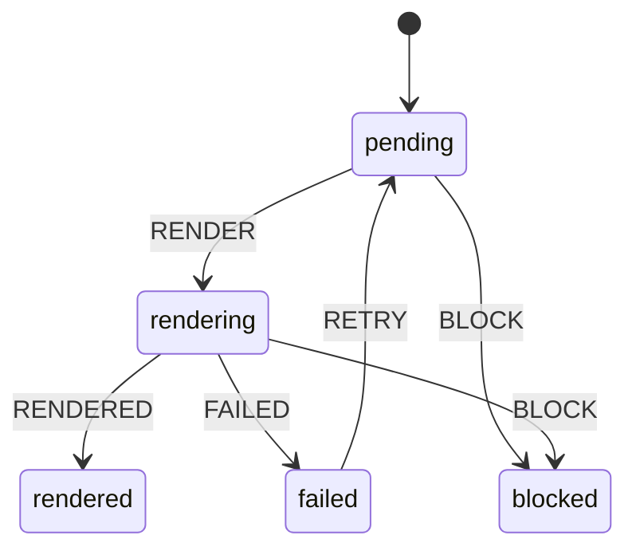

## document

What the editor holds: the untouched welcome guide, nothing, a draft, or an imported file, whose name exports reuse. Clearing the editor forgets the file's name. The untouched guide isn't saved, so the next visit shows the current one.

- Defined in [`lib/machines/document.js`](../lib/machines/document.js)
- State shown on `#editor`
- Context: `filename`

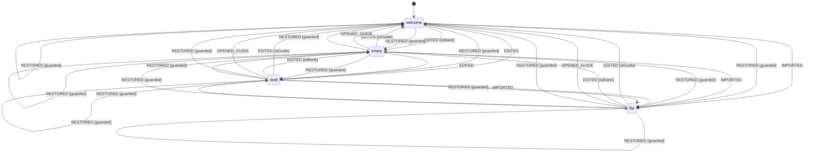

## dropOverlay

Dragging a file over the window. The overlay says whether dropping will open it; drags that start inside the page, such as selected text, keep their usual behavior.

- Defined in [`lib/machines/overlays.js`](../lib/machines/overlays.js)
- State shown on `#dropOverlay (data-state is ready or unsupported while a file is over the window)`
- Context: `allowed`

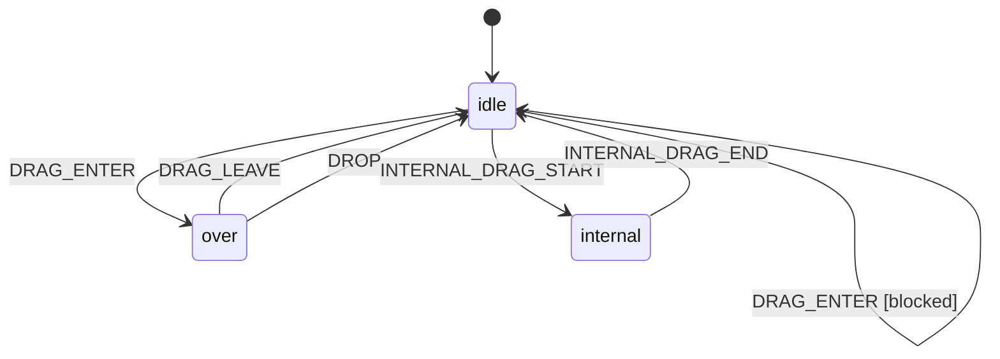

## editorPane

The editor beside the preview on wide screens: open, or collapsed so the preview fills the window. Importing a file or pasting a whole document collapses it for reading, unless the reader reopened it after that before, which means they want to edit. Both the state and the width are saved.

- Defined in [`lib/machines/layout.js`](../lib/machines/layout.js)
- State shown on `#editorPane`
- Context: `width`, `autoCollapse`, `collapsedForReading`

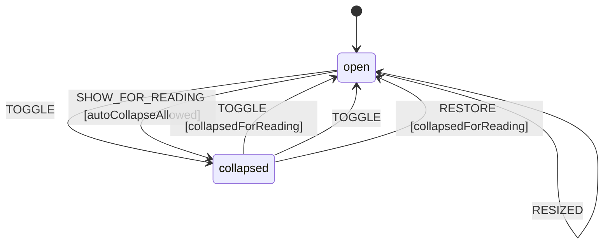

## exportDialog

The HTML and PDF export dialog, from choosing options until the file downloads or the print dialog closes. The page shows the export theme while an export runs.

- Defined in [`lib/machines/export-dialog.js`](../lib/machines/export-dialog.js)
- State shown on `#exportDialog`
- Context: `format`, `theme`, `run`

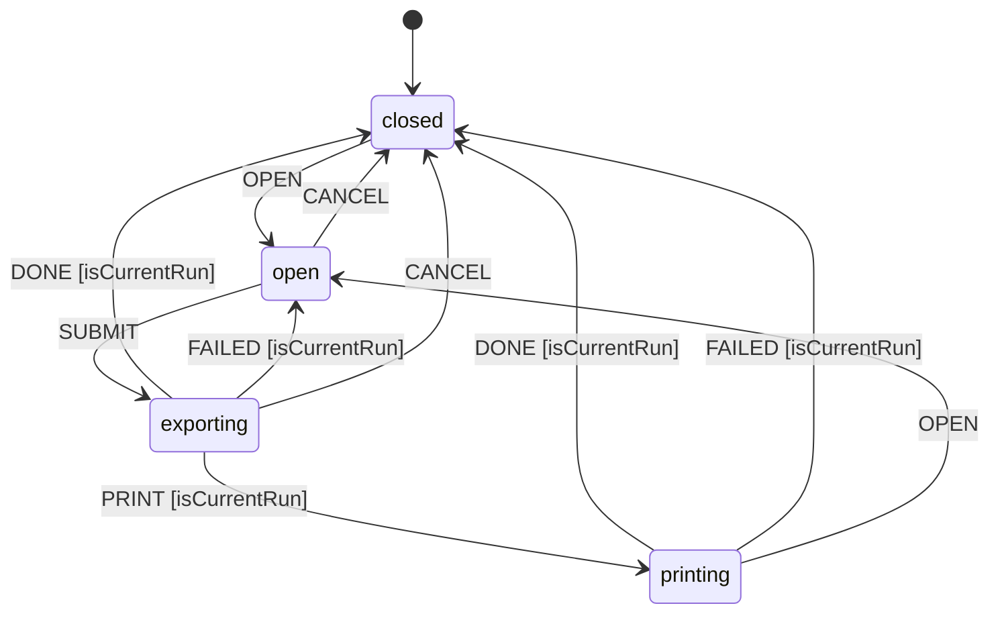

## exportMenu

The Export menu of formats. Choosing one, Escape, or clicking or tabbing away closes it.

- Defined in [`lib/machines/menus.js`](../lib/machines/menus.js)
- State shown on `#exportMenu`

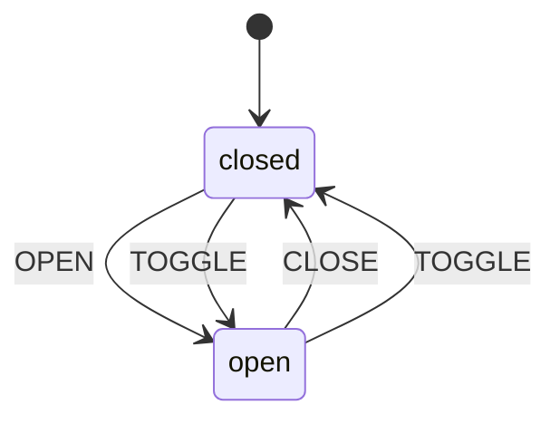

## headerMenu

The "More options" panel that holds the header controls on narrow screens. Toggles and the Export submenu keep it open; other actions, Escape, clicking or tabbing away, and resizing to a wide screen close it.

- Defined in [`lib/machines/menus.js`](../lib/machines/menus.js)
- State shown on `#headerMenu`

## import

Opening a file from the Import button, a drop, or the operating system. Replacing the reader's own work asks first; the latest file wins when several arrive close together.

- Defined in [`lib/machines/import.js`](../lib/machines/import.js)
- State shown on `#importConfirmDialog`
- Context: `run`, `filename`, `text`

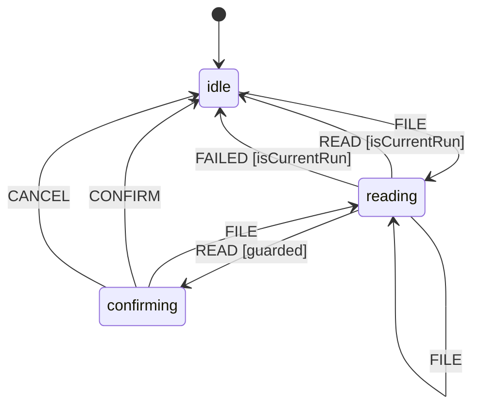

## lint

Checking the markdown for common problems, when turned on (saved). Results arrive a moment after typing stops and show in the gutter and the lint panel.

- Defined in [`lib/machines/lint.js`](../lib/machines/lint.js)
- State shown on `#lintToggle`
- Context: `warnings`

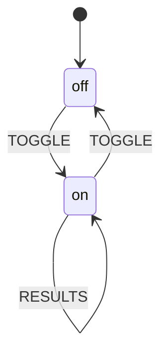

## mediaViewer

The full screen view of a diagram or image. Closing it returns focus to the button or image that opened it.

- Defined in [`lib/machines/overlays.js`](../lib/machines/overlays.js)
- State shown on `#mediaViewerDialog`
- Context: `trigger`

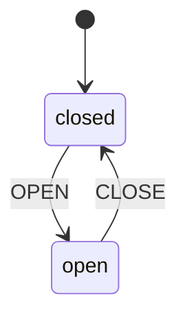

## mobileView

Which pane a narrow screen shows: the editor or the preview, chosen with the tabs and saved. Wide screens show both and ignore it.

- Defined in [`lib/machines/layout.js`](../lib/machines/layout.js)
- State shown on `#mobileViewSwitcher`

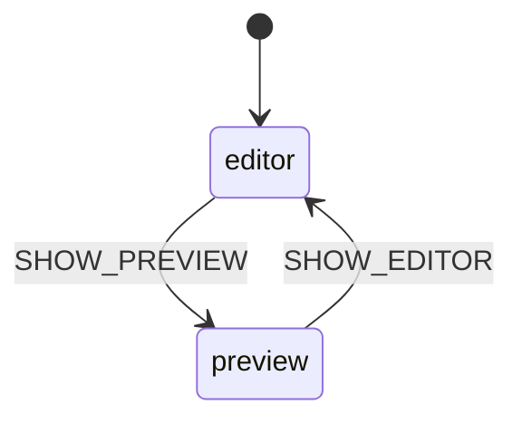

## outline

The list of the document's headings. It shows only while open and the document has headings (data-state is empty when it has none). On wide screens it is a side panel that stays open between visits; on narrow ones it covers the preview, opens only on request, and closes after jumping to a heading.

- Defined in [`lib/machines/outline.js`](../lib/machines/outline.js)
- State shown on `#outlinePanel`
- Context: `hasHeadings`

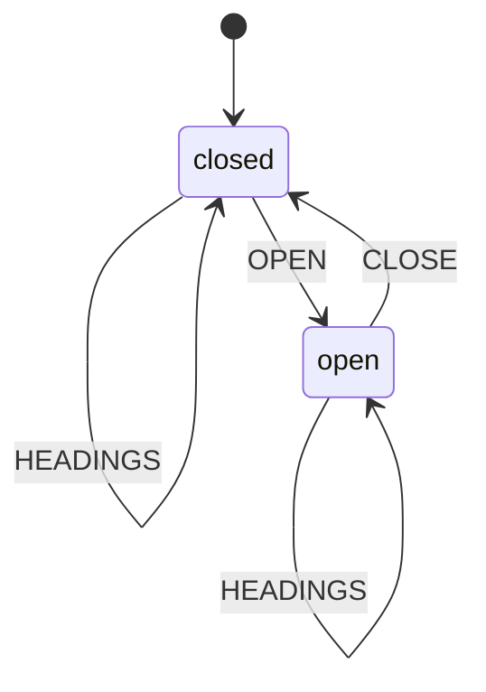

## previewRender

Rendering the preview at most once per animation frame. A forced render, needed when something other than the markdown changed, isn't lost when it joins one already waiting.

- Defined in [`lib/machines/preview.js`](../lib/machines/preview.js)
- Context: `force`

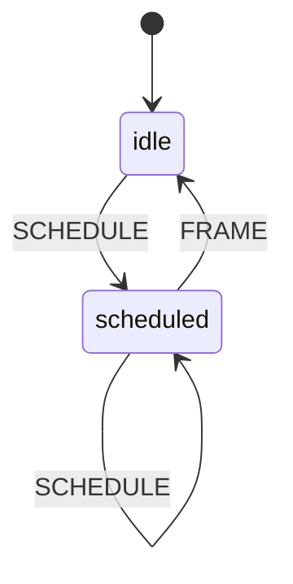

## remoteImages

Whether the preview blocks images from other sites until the reader chooses to load them (saved). Turning it on or off, or opening another document, forgets which images were let through.

- Defined in [`lib/machines/remote-images.js`](../lib/machines/remote-images.js)
- State shown on `#remoteImagesToggle`

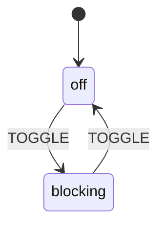

## resize

Dragging the handle between the editor and the preview. A cancelled drag, such as an interrupted touch, puts the width back.

- Defined in [`lib/machines/layout.js`](../lib/machines/layout.js)
- State shown on `#resizeHandle`
- Context: `startX`, `startWidth`, `width`

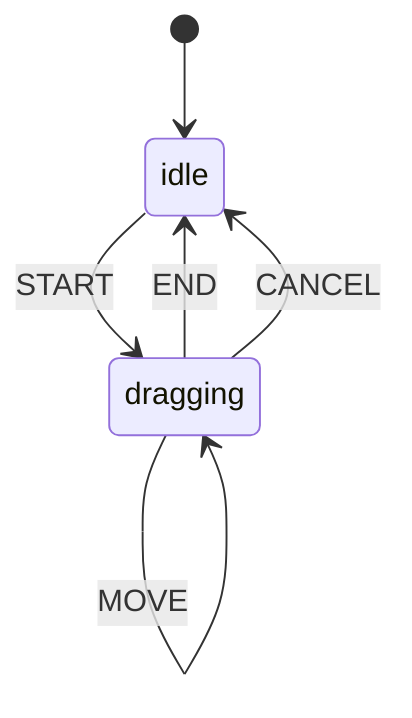

## scrollSync

Keeping the editor and preview scrolled to the same place, when turned on (saved). The pane being scrolled leads, and the other follows until it's been still briefly.

- Defined in [`lib/machines/layout.js`](../lib/machines/layout.js)
- State shown on `#scrollSyncToggle`

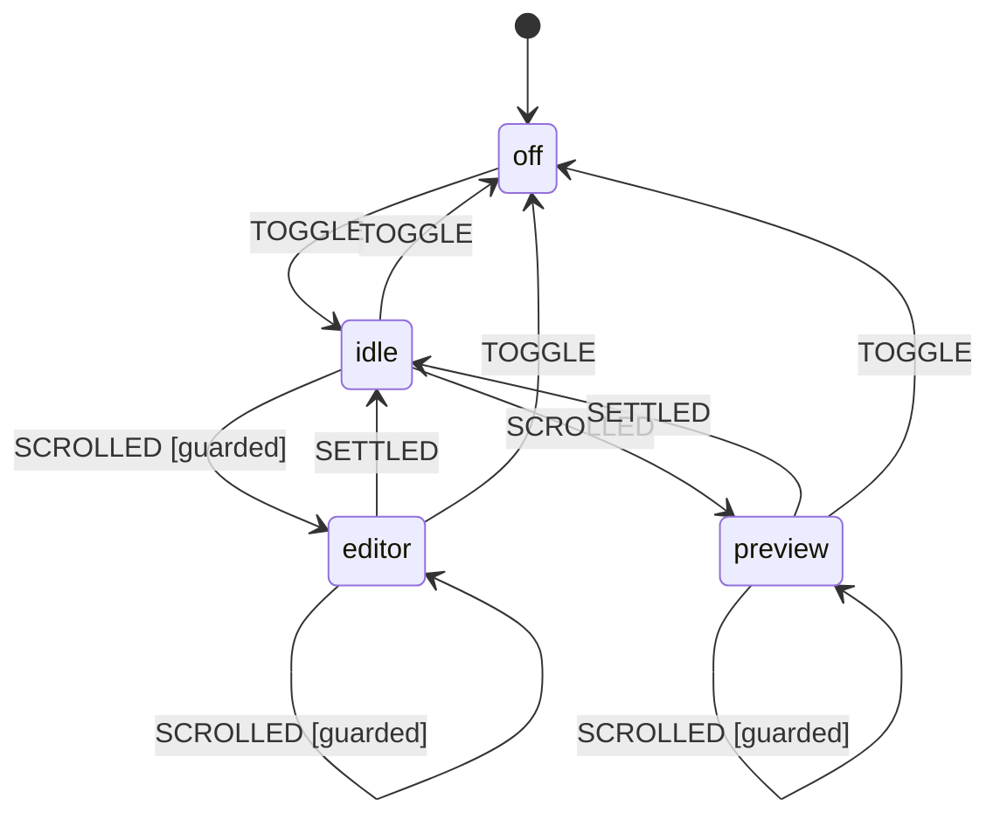

## theme

The color theme. It follows the system's until the reader picks one with the toggle, which is saved. An export can show its own theme until it finishes.

- Defined in [`lib/machines/theme.js`](../lib/machines/theme.js)
- State shown on `html (data-theme-state; data-theme holds the theme shown)`
- Context: `system`, `chosen`, `override`

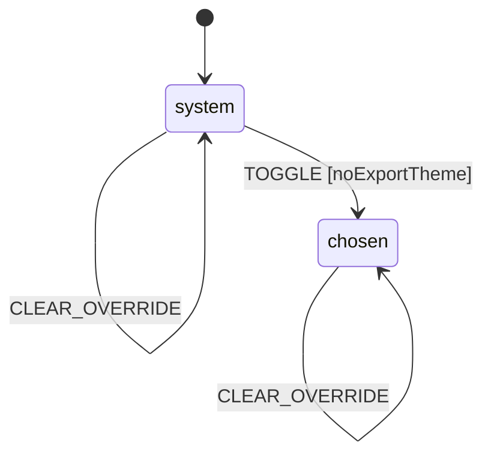

## toast

The status message at the bottom of the window. It hides after a while unless the reader is pointing at or tabbing through it. A toast with an action isn't lost when another one arrives: it comes back once the newer toast is gone.

- Defined in [`lib/machines/toast.js`](../lib/machines/toast.js)
- State shown on `#mdToast`
- Context: `current`, `suspended`

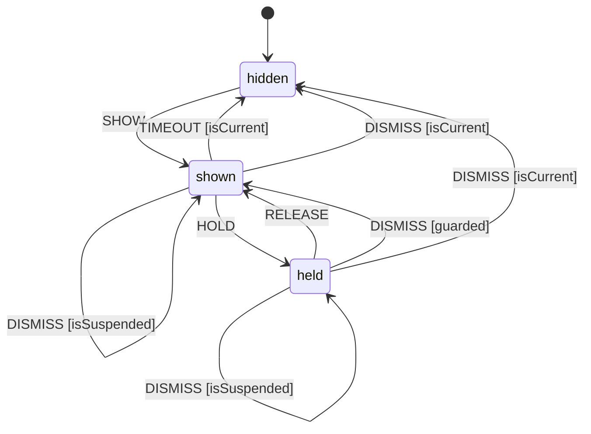

## tooltip

The tooltip for whatever element with data-tooltip is hovered or focused. It hides when the pointer or focus leaves, and when its element is removed from the page, such as a lint warning icon the gutter redraws.

- Defined in [`lib/machines/overlays.js`](../lib/machines/overlays.js)
- State shown on `.gutter-tooltip`
- Context: `anchor`

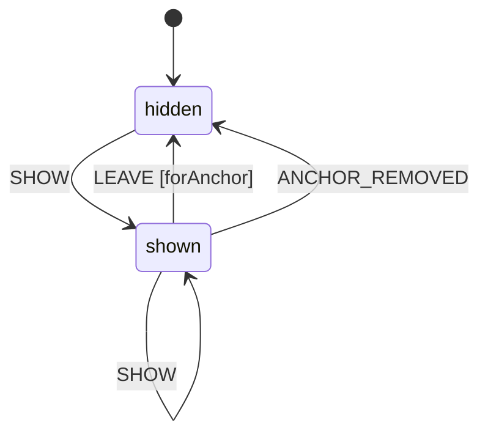

## vendorLoader

Loading a heavy library the first time the preview needs it: highlight.js for code, KaTeX for math, Pele for diagrams. It counts as loaded only once all of it is, and it's tried again after a failure. In development these run as hljsLoader, katexLoader, and mermaidLoader.

- Defined in [`lib/machines/vendor-loader.js`](../lib/machines/vendor-loader.js)

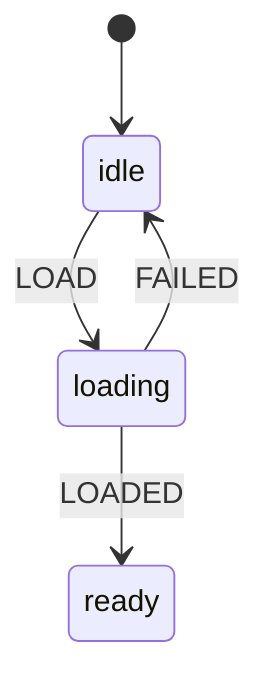
