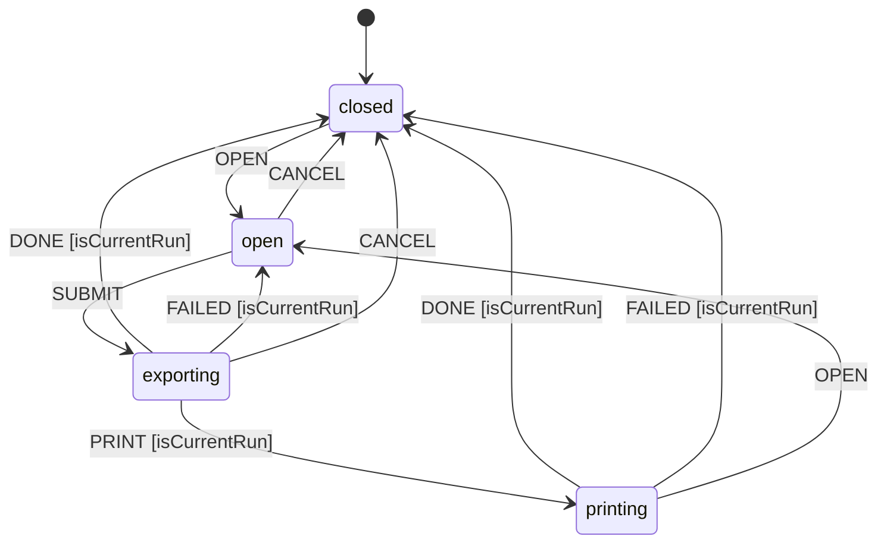
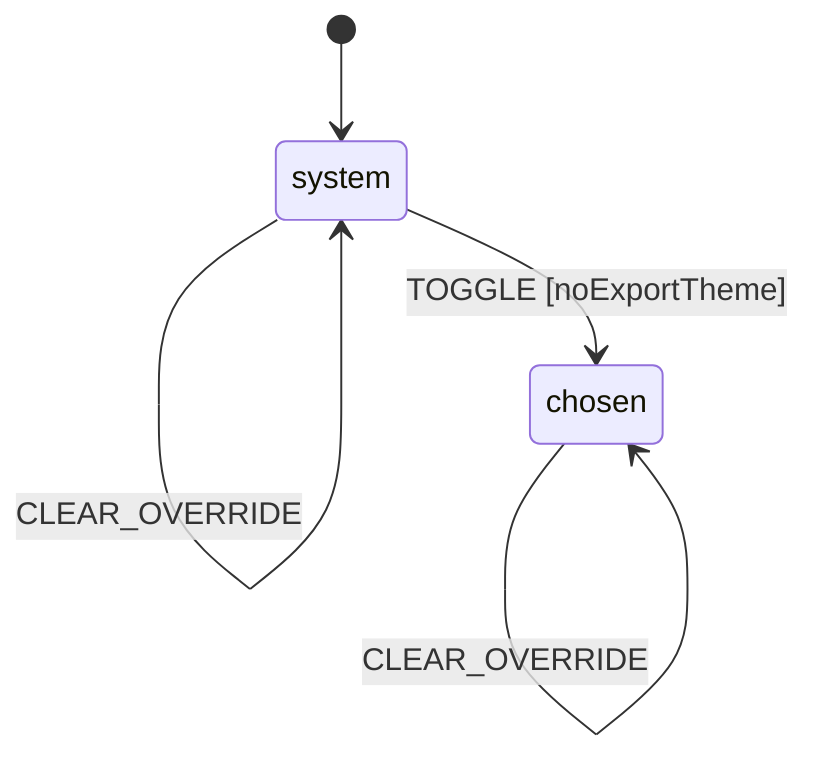
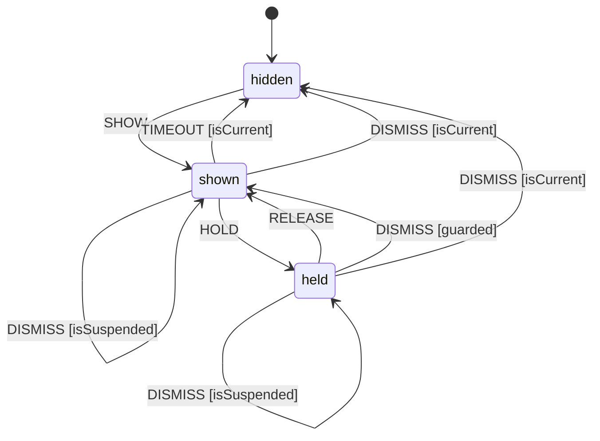

# State machines

<!-- Generated by `npm run docs:machines` from lib/machines/. Edit the definitions, not this file. -->

Every piece of app state that changes over time runs as a finite state machine built with
[`lib/machine.js`](../lib/machine.js). Each definition in `lib/machines/` is pure data: its
states, the events each one accepts, and where each event leads. A state ignores any event
it doesn't list. The module that runs a machine performs its side effects in a listener and
writes the current state to a `data-state` attribute, which tests and devtools can read. In
development, `window.__machines` holds every running machine.

Arrows show `EVENT [guard]`. An arrow back to the same state changes only the context.

## exportDialog

The HTML and PDF export dialog, from choosing options until the file downloads or the print dialog closes. The page shows the export theme while an export runs.

- Defined in [`lib/machines/export-dialog.js`](../lib/machines/export-dialog.js)
- State shown on `#exportDialog`
- Context: `format`, `theme`, `run`

## theme

The color theme. It follows the system's until the reader picks one with the toggle, which is saved. An export can show its own theme until it finishes.

- Defined in [`lib/machines/theme.js`](../lib/machines/theme.js)
- State shown on `html (data-theme-state; data-theme holds the theme shown)`
- Context: `system`, `chosen`, `override`

## toast

The status message at the bottom of the window. It hides after a while unless the reader is pointing at or tabbing through it. A toast with an action isn't lost when another one arrives: it comes back once the newer toast is gone.

- Defined in [`lib/machines/toast.js`](../lib/machines/toast.js)
- State shown on `#mdToast`
- Context: `current`, `suspended`

