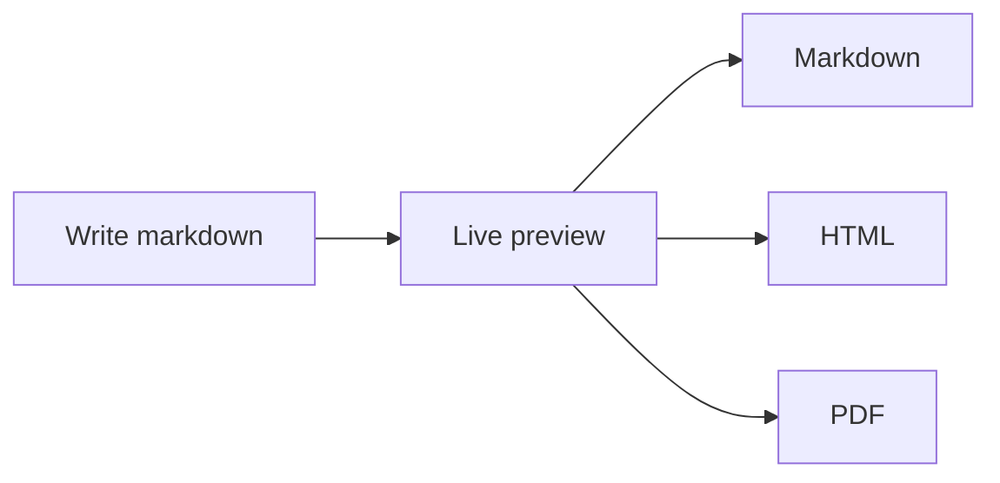

# Welcome to mdfor.dev ✨

A fast, private online markdown editor with live preview: write in the editor and the preview updates as you type. Everything stays in this browser: no account, no server, no tracking.

This page is a sample document, so go ahead and change it, clear it, or import your own file. You can bring it back any time with the **?** button in the header (**Welcome guide** in the menu on phones).

> [!TIP]
> Your document saves automatically on this device. Use **Export** whenever you want a copy somewhere else.

## Getting around

- Open a file with **Import** or <kbd>Cmd/Ctrl</kbd> + <kbd>O</kbd>, or drop a `.md` file anywhere on the page.
- Save a copy with **Export**: Markdown, HTML, or PDF. <kbd>Cmd/Ctrl</kbd> + <kbd>S</kbd> downloads the `.md`.
- Read without the editor by collapsing it with the arrow beside **Markdown**, or <kbd>Cmd/Ctrl</kbd> + <kbd>\\</kbd>.
- Jump to a section with **Outline**.
- Scroll both panes together with scroll sync (the link icon).
- Catch style issues with **Markdown linting**, then click a warning to jump to its line.
- Stop other sites from seeing when your document loads their images with **Block remote images**.
- Switch between light and dark with the sun and moon button.

On a phone, these controls live under the **⋯** menu. Switch between the editor and the preview with the tabs at the top.

After your first visit, mdfor.dev works offline. In Chrome or Edge you can also install it as an app and open `.md` files straight from your file manager.

## What you can write

Everything below is plain markdown. Look at the editor to see how each part is written.

### Text

**Bold**, _italic_, ~~strikethrough~~, <mark>highlighted</mark>, `inline code`, and keys like <kbd>Esc</kbd>. Links work as usual: [Markdown Guide](https://www.markdownguide.org), or [a heading on this page](#math).

### Lists

1. Numbered lists
2. Count for you

- Bullets work too
- [x] Task lists render as checkboxes
- [ ] This one is still to do

### Quotes and alerts

> "The best writing is rewriting."\
> — E.B. White

> [!NOTE]
> GitHub-style alerts come in five kinds: `NOTE`, `TIP`, `IMPORTANT`, `WARNING`, and `CAUTION`.

> [!WARNING]
> Clearing your browser's site data also clears the document saved here.

### Code

Code blocks are highlighted by language and get a copy button.

```javascript
const greeting = 'Hello, Markdown!';
console.log(greeting);
```

### Tables

| Syntax        | Example             |
| ------------- | ------------------- |
| Bold          | `**bold**`          |
| Italic        | `_italic_`          |
| Strikethrough | `~~strikethrough~~` |

### Math

Inline math like $a^2 + b^2 = c^2$, or a block equation:

$$
f(x) = \int_{-\infty}^{\infty} \hat{f}(\xi)\, e^{2 \pi i \xi x}\, d\xi
$$

### Diagrams

Mermaid code blocks become diagrams. Use the buttons on a diagram to view it full screen or copy and download it as a PNG.



### Images

Click an image to view it full screen.


### Footnotes

Footnotes are numbered for you and collected at the end of the document.[^1]

### Frontmatter

A YAML block at the very top of a file appears as a small metadata table, like on GitHub:

```yaml
---
title: Release notes
tags: [changelog, v2]
---
```

---

**Happy writing!** 🚀

[^1]: Each one links back to where it was referenced.
